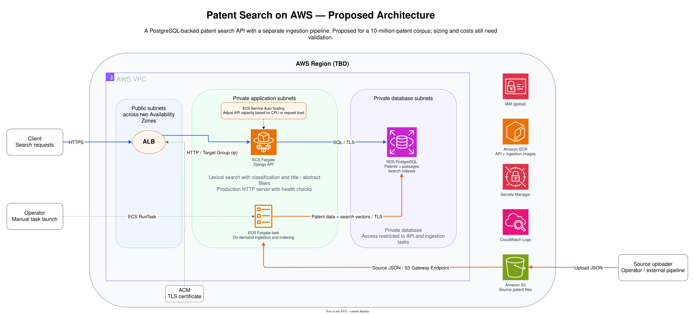

# Part 2 — Patent search on AWS

**Status: proposed, not deployed.** This design takes the Part 1 search engine
toward a corpus of 10 million patents. That is the target, not a capacity we have
demonstrated. The [cost estimate](part-2-costs.md) uses explicit working assumptions
for a N. Virginia budget; these are not validated production requirements.

[Editable draw.io diagram](diagrams/architecture.drawio).
Open it in diagrams.net or a compatible editor. After changing the source,
export a new SVG to keep the preview in sync.

## The idea

Keep search and ingestion separate. Users need a responsive API, while importing
patent text can be a long-running job. Both use PostgreSQL, but they run in
different containers and can be operated independently.

We keep the lexical search from Part 1: PostgreSQL search vectors (`tsvector`),
a GIN index and structured filters. These are not AI embeddings. There is no
embedding model or vector database in this proposal.

## When someone searches

The client sends an HTTPS request to an Application Load Balancer (ALB). ACM
provides its TLS certificate. The ALB forwards the request to a healthy API task
in an ECS Fargate service, using an IP target group.

The task runs Django behind a production HTTP server, rather than the development
server used locally. It queries RDS PostgreSQL over TLS and returns matching
patents with excerpts and source references. Normal searches do not read the
original files from S3.

ECS Service Auto Scaling adjusts the number of API tasks based on CPU usage or
requests per target. We still need to choose minimum/maximum task counts and test
the scaling policy. Fargate manages the underlying compute, so there is no EC2
Auto Scaling Group to maintain. Adding API tasks does not make database queries
faster or increase database capacity automatically.

## When new patent files arrive

An operator or an external pipeline uploads the original JSON files to S3. An
operator then launches a separate Fargate task with ECS `RunTask`.
Uploading to S3 does not automatically start ingestion in this design.

The proposed worker reads one source at a time, validates records and writes
bounded batches to PostgreSQL. It builds the search vectors and records progress
so an interrupted import can resume. The diagram's S3 → worker arrow shows where
the content goes; the worker actually initiates the S3 read.

This requires changes to the local implementation, which currently validates the
whole sample in memory, imports it in one transaction and rebuilds the index
explicitly. Deploying that command unchanged would not solve ingestion at scale.

### What goes where

| Store | Contents |
|---|---|
| S3 | Original JSON files and source manifests/checksums |
| RDS PostgreSQL | Patent metadata, claims, description passages, search vectors and indexes |
| RDS PostgreSQL, proposed additions | Import progress, failures, index-readiness state and references back to S3 objects |

Keep original files immutable. Record their object key, version/checksum and
record position so a search result can be traced back to its source.

## Network and access

The ALB uses public subnets across two Availability Zones. API and ingestion
tasks have no public IPs and run in private application subnets. RDS sits in
private database subnets; its security group permits PostgreSQL traffic only
from the API and ingestion security groups. The database subnet group spans
two AZs, but whether to pay for a Multi-AZ database deployment is still undecided.

Private tasks also need a way to reach AWS services. An S3 Gateway Endpoint lets
them read S3 through the application subnet route tables. For a setup without NAT,
plan interface endpoints for ECR API/Docker, Secrets Manager and CloudWatch Logs;
ECR image layers also require S3 access. Endpoint policies, security groups and
private DNS must allow those connections. Compare their per-AZ costs with a NAT
option before choosing the final configuration. Calls to external public APIs
would need a separate outbound-access plan.

The remaining services support the containers rather than sit in the search path:

- **ECR** holds the API and ingestion images.
- **Secrets Manager** holds runtime credentials; do not put them in images.
- **IAM**, a global service, provides separate execution and application task
  roles. Execution roles allow image pulls, log delivery and secret injection;
  the ingestion task role allows the code to read its designated S3 sources.
- **CloudWatch Logs and metrics** make failures visible. Add alarms for API
  errors/latency, task failures and database pressure, with bounded log retention.

Shared support connections are omitted from the diagram to keep it readable.
Solid arrows show requests or content flow; dashed arrows show control or
configuration, not the complete packet path.

## What happens when something fails?

These are proposed behaviours, not features already implemented:

- Identify an import by source key and checksum. Retrying the same source must
  not duplicate its records. Conflicting content needs an explicit version policy;
  the local importer currently rejects conflicts rather than overwriting them.
- Commit bounded batches with durable checkpoints. After a failure, resume from
  the last committed batch instead of restarting the entire corpus.
- Track a small lifecycle such as `pending → running → indexed`, with `failed`
  and an error reason. Mark data searchable only when its required derived search
  data is ready; a successful file upload is not a successful import.
- Keep API readiness separate from a simple database connectivity check. The
  current health endpoint does not prove that ingestion or indexing is complete.
- Plan backups and test restores before treating the database as production-ready.
  Availability and recovery targets will determine whether Multi-AZ is justified.

## What changes at 10 million patents?

PostgreSQL is our starting point, not a guarantee that any chosen RDS instance
will handle this corpus. We need representative text sizes, index sizes and
query load to size it responsibly.

The current Python scans for literal title/abstract filters must become indexed
database lookups that preserve the same matching rules. Ranking, exact match
counts, deep pagination and excerpt selection also need realistic query plans
and load tests. Ingestion must be throttled so its writes and index maintenance
do not overwhelm interactive searches.

We are not adding Aurora, API Gateway, a queue or a second search backend without
a concrete reason. RDS PostgreSQL and an ALB are the simpler initial proposal;
we can revisit them if measurements show a limitation.

## Next steps

1. Agree on query load, ingestion frequency, latency and availability targets.
2. Refine the [approximate costs](part-2-costs.md) after measuring representative
   text sizes, index growth and query load. Recheck prices before deployment.
3. Extend the [verified container-ingestion PoC](part-2-poc.md) only when needed:
   S3 reads, bounded batches and durable progress are not implemented locally.

The [Part 1 local architecture](part-1-local.md) describes what is implemented today.
The [cost estimate](part-2-costs.md) and [local PoC](part-2-poc.md) accompany this
proposal. None deploys AWS resources or demonstrates capacity at scale.
